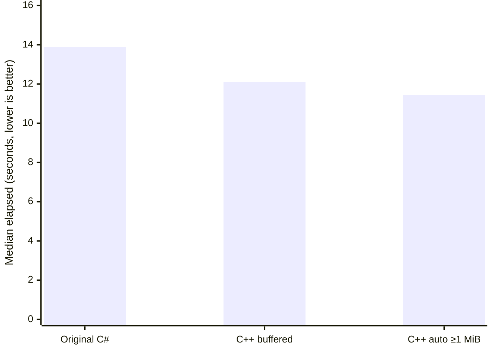

# nuxe

A Linux-focused fork of [JKAnderson/Nuxe](https://github.com/JKAnderson/Nuxe).
Mostly a side project because I'm bored and want to make archive I/O fast.

## Current support

**DS2 only for now.** The table compares the original Nuxe's supported games
with this C++ fork. Original platform labels describe archive formats, not the
platforms this fork runs on.

| Game / archive version | Original Nuxe unpacking | Inspect JSON | Extract one file | Unpack game directory | Decrypt headers / payloads | Original filenames |
| --- | --- | --- | --- | --- | --- | --- |
| Armored Core V (PS3, Xbox 360) | Yes | No | No | No | No | No |
| Armored Core: Verdict Day (PS3, Xbox 360) | Yes | No | No | No | No | No |
| Armored Core VI (PC) | Yes | No | No | No | No | No |
| Dark Souls (PC, PS3, Xbox 360) | Yes | No | No | No | No | No |
| Dark Souls Remastered (Switch) | Yes | No | No | No | No | No |
| Dark Souls II (PC) | Yes | Yes* | Yes* | Yes* | Yes* | No |
| Dark Souls II: Scholar of the First Sin (PC) | Yes | Yes | Yes | Yes | Yes | No |
| Dark Souls III (PC) | Yes | No | No | No | No | No |
| Elden Ring (PC) | Yes | No | No | No | No | No |
| Elden Ring Nightreign (PC) | Yes | No | No | No | No | No |
| Sekiro, including Digital Artwork & Mini Soundtrack (PC) | Yes | No | No | No | No | No |
| Steel Battalion: Heavy Armor (Xbox 360) | Yes | No | No | No | No | No |

All feature columns after “Original Nuxe unpacking” describe this fork.
“No” means not implemented. DS2 extraction supports RSA headers and AES payloads;
outputs use numbered bucket/file paths. Scholar of the First Sin has been tested
against the original unpacker. *The original DS2 uses the implemented DS2 path but
hasn't been validated against a full game installation here.

Extraction uses parallel workers with bounded buffers and buffered copying by
default. Linux kernel copying is optional through `--copy-mode auto`, with
buffered fallback. Executable patching isn't implemented. Browser CPU profiling
is available through mise; some C++ module names remain mangled.

**Linux only.** Windows support isn't planned right now. I don't have a Windows
machine, and I don't know Windows I/O well enough to promise a proper port.
Maybe a rough Windows version happens later, or someone sends a PR. Windows PRs
are welcome, but for now this is a Linux project. Other platforms aren't
supported either.

## Build from source

Install [mise](https://mise.jdx.dev/) and [Xmake](https://xmake.io/), then run these
commands from the repository root. Mise supplies the configured compiler tools;
Xmake resolves the C++ dependencies.

```bash
mise trust
mise install
mise run build
```

The executable is `build/linux/x86_64/release/nuxe` on Linux x86-64.
The examples below use Bash-compatible shell syntax and run from the repository
root.

## Unpack a game

Point nuxe at the directory containing the game's `.bhd`, `.bdt`, and `.pem` files:

```bash
GAME="/path/to/Dark Souls II Scholar of the First Sin/Game"

./build/linux/x86_64/release/nuxe unpack "$GAME" \
    --output "$HOME/ds2-unpacked"
```

Nuxe finds the archive pairs and their matching encryption keys automatically.
Each archive gets its own output directory:

```text
ds2-unpacked/
  GameDataEbl/
    0/
      0.bin
      1.bin
  LqChrEbl/
    ...
```

The numbers are zero-based bucket and file indices from the archive header.
Inputs are read only. Output directories are created automatically, and existing
files cause an error unless you pass `--replace`. If extraction fails, completed
files remain and newly created incomplete files are removed on a best-effort
basis. A failed replacement can leave an existing file partial.

To unpack just one archive, pass its header instead. The matching data archive
and key are inferred from its name:

```bash
./build/linux/x86_64/release/nuxe unpack "$GAME/LqMapEbl.bhd" \
    --output "$HOME/ds2-map"
```

For nonstandard filenames, supply the data archive and key explicitly:

```bash
./build/linux/x86_64/release/nuxe unpack header.bhd data.bdt \
    --key public-key.pem --output unpacked
```

Decrypted headers don't need a key. Single-archive outputs use
`<output>/<bucket>/<file>.bin`.

Useful `unpack` options:

| Option | Behavior |
| --- | --- |
| `--jobs N` | Limit workers. Defaults to at most 2 available hardware threads. |
| `--buffer-size N` | Buffer bytes per worker. Defaults to 65536 (64 KiB). |
| `--replace` | Replace existing output files. |
| `--eat-all-cpu` | Keep inherited CPU and I/O priority instead of lowering it. |
| `--stats` | Print stage timings, workload counts and copy counters to stderr. |

Background CPU and I/O priority is the default. Buffers must be at least 16 bytes
when extracting encrypted payloads.

## Inspect a header or extract one file

`inspect` writes JSON containing bucket indices, file indices, offsets, sizes,
and encryption metadata. Save it to a file to explore without flooding the
terminal:

```bash
./build/linux/x86_64/release/nuxe inspect "$GAME/LqMapEbl.bhd" \
    --key "$GAME/LqMapKeyCode.pem" > "$HOME/ds2-header.json"
```

Use indices from that JSON to extract one payload:

```bash
./build/linux/x86_64/release/nuxe extract \
    "$GAME/LqMapEbl.bhd" "$GAME/LqMapEbl.bdt" \
    --key "$GAME/LqMapKeyCode.pem" \
    --bucket 0 --file 0 --output "$HOME/ds2-payload.bin"
```

The `extract` command requires both archive paths. Its `--jobs` option controls
header decryption only; the selected payload is copied by one worker.

All commands support `--help`. Errors go to stderr and return a nonzero exit
status; inspection JSON and successful extraction summaries go to stdout.

## Development

The rewrite uses C++23 native modules, Clang, and Xmake. The original C# source is
kept in ignored `old_code/` for reference.

```bash
mise run dev        # Debug build
mise run format     # Format C++ sources
mise run compiledb  # Regenerate clangd's compilation database
```

### Copying and performance

#### Cold-cache Scholar extraction

Full-game extraction: 16,289 files, 18.17 GB. Three release trials per
configuration on an Intel i5-11500H and Samsung MZVLB512HBJQ NVMe, with source
and output on the same Btrfs filesystem (`compress=zstd:3`). Each trial used a
fresh output directory; all BDT payload pages were evicted and verified
nonresident with `mincore()` before timing. This measures cold payload data,
not a reboot or cold filesystem metadata.

| Extractor | Median elapsed | Range |
| --- | ---: | ---: |
| Original C# extraction engine | 13.89 s | 12.82–13.99 s |
| C++ buffered | 12.10 s | 11.41–12.59 s |
| C++ auto, plain files ≥1 MiB | 11.45 s | 11.22–12.11 s |



The thresholded auto configuration used 17.5% less elapsed time than the C#
engine in these trials. **The under-10-second cold-cache target is not met.**
The C++ ranges overlap, so the smaller auto gain needs care when generalizing
to other drives or filesystems. Buffered copying remains the default.

C++ measurements used two workers, 64 KiB buffers and `--eat-all-cpu`, matching
the C# engine's inherited priority. To select the measured auto configuration:

```bash
./build/linux/x86_64/release/nuxe unpack "$GAME" --output "$OUT" \
    --jobs 2 --buffer-size 65536 --eat-all-cpu \
    --copy-mode auto --cfr-min-size 1048576
```

The comparison runs the unchanged original C# extraction engine from revision
`16d94fcd379f45721047a0c2b7b743e84b4fa08b` through a small Linux console adapter
on .NET 10.0.2. It includes dictionary lookup and original filenames, while this
fork uses numbered paths. It does not measure the Windows WPF application.
All 16,289 extracted payloads were verified against the original engine with
SHA-256. Elapsed times include process startup and file closure, without an
`fsync`; they do not measure durable storage completion.

#### Extraction controls

Unpacking defaults to at most two workers and a 64 KiB buffer per worker.
Buffered copying is the default. `unpack --copy-mode auto` opts into Linux
`copy_file_range()` for unencrypted files, with buffered fallback when unsupported.
Encrypted entries always use the buffered AES path. `--copy-mode buffered`
explicitly selects the default for comparisons. `--cfr-min-size N` limits kernel
copy attempts to plain files of at least N bytes (default: 0). An unavailable
kernel syscall is remembered per worker; filesystem-specific failures retain
buffered fallback.

Use `--stats` for header, planning, input protection, worker setup, directory and
payload timings, plus file/group/key/range counts and actual copy bytes/errors.
CFR nanoseconds sum syscall durations across workers, so they can exceed elapsed
time. `--group-files` and `--group-bytes` expose scheduling experiments; their
defaults remain 64 files and 64 MiB.

Use identical worker counts and buffer sizes, fresh outputs on the same
filesystem, and repeat runs in alternating order. Cross-device copies may fall
back, so automatic copying isn't guaranteed to be faster. Completion checks close
errors but does not imply an fsync to storage.

### Browser profiling

Install the system `perf` tool; Samply is managed by mise. Pass any nuxe command
to the single profiling task:

```bash
PROFILE_OUT=$(mktemp -d "$HOME/nuxe-profile.XXXXXX")
mise run profile -- unpack "$GAME" --output "$PROFILE_OUT"
```

This builds optimized code with debug symbols and frame pointers, records
userspace CPU stacks, and opens Firefox Profiler in your browser. Leave the
terminal running; Ctrl-C stops the local server. Run `mise run profile` without
arguments to reopen the latest recording.

Profiles stay local under ignored `.cache/profiles/` unless you upload them.
Unpacked files remain in the output directory you chose. Samples describe CPU
activity, excluding blocked I/O and kernel execution, rather than exact function
wall times. Compare real disk workloads separately from warm-cache or RAM-backed
runs.
